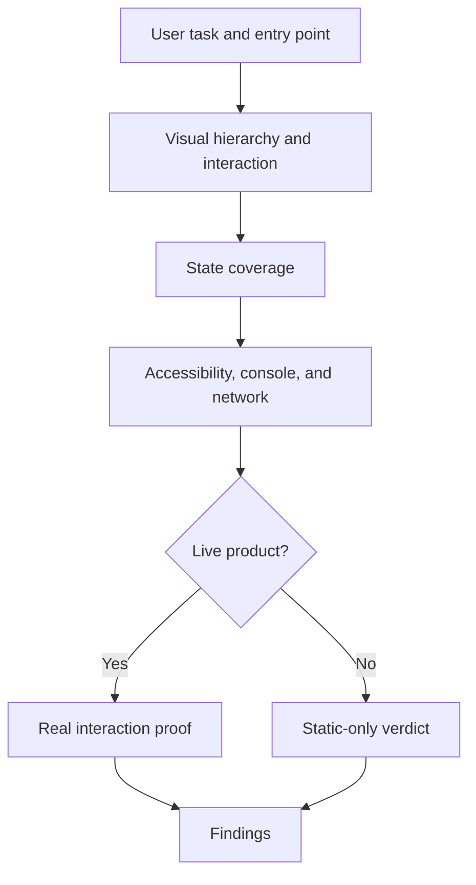
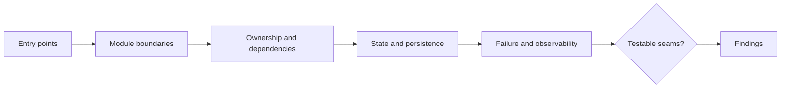
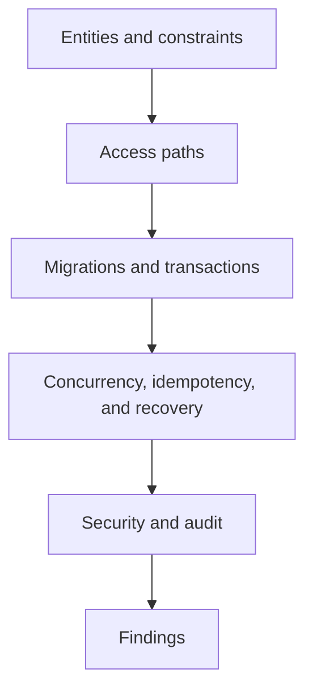
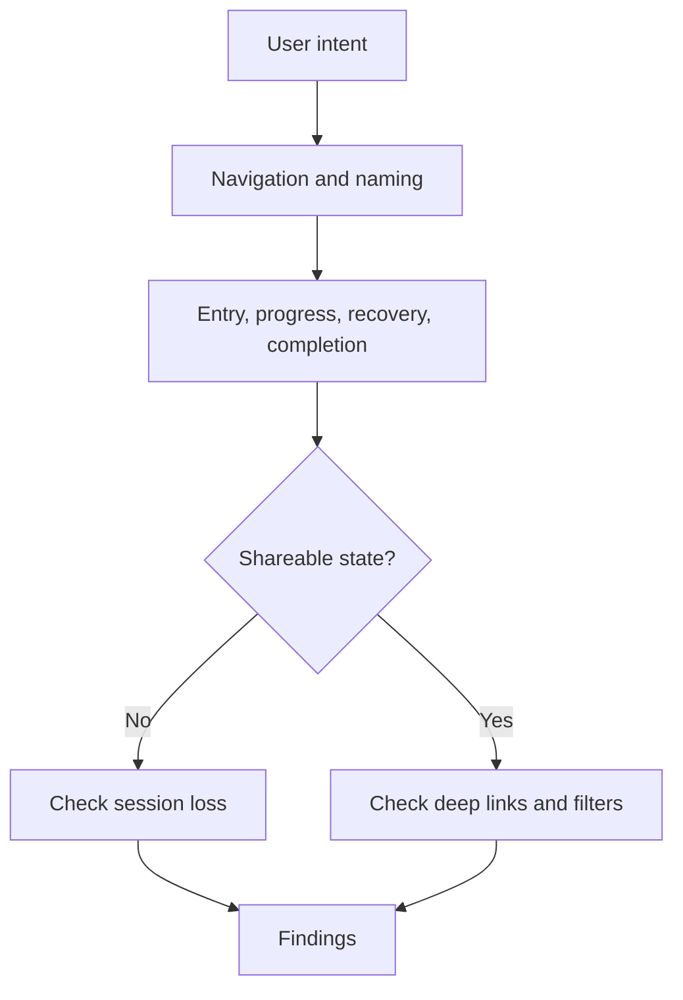
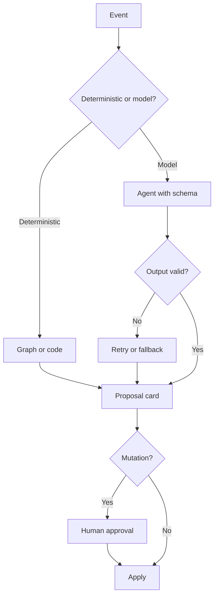
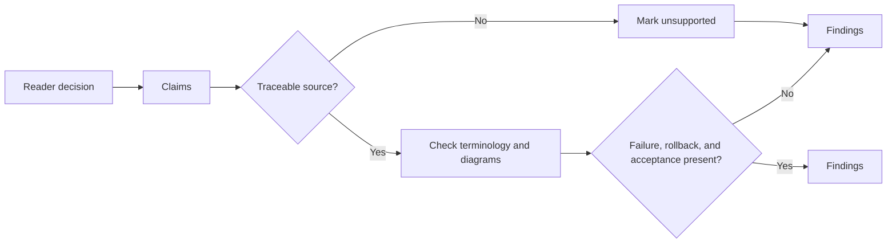

# Audit Compositions

Use the co-selected domain skill as the domain lens. Keep this skill responsible for evidence, verdict, coverage, and persistence. The list below is not exhaustive; when another domain skill is available, derive the checklist from its instructions and apply the same audit contract.

## Frontend / web product

Pair with `frontend-design`, `design-system`, `ux-audit`, or `agent-browser` when available.

Inspect:

- User tasks and entry points, not just rendered components.
- Visual hierarchy, typography, spacing, color, icon use, and responsive behavior.
- State coverage: loading, empty, partial, error, disabled, success, and destructive confirmation.
- Interaction proof: focus, keyboard use, form validation, primary action result, navigation, and back behavior.
- Accessibility basics: contrast, labels, roles, focus visibility, touch target size, reduced motion.
- Console errors, failed requests, layout overflow, and text truncation.
- Consistency with the existing design system and interface conventions.

For a live app, do not give a Pass verdict without real interaction evidence. Static screenshots and DOM inspection can support findings but cannot prove the whole product works.

## Architecture / codebase

Pair with `improve-codebase-architecture` when the user explicitly invokes it, or use the architecture lens directly.

Inspect:

- Module boundaries, ownership, dependencies, and circular or accidental coupling.
- Where a concept is implemented and whether it is easy to find, test, and change.
- Interface depth: does the public interface hide necessary complexity without leaking implementation details?
- State ownership, persistence, invalidation, and recovery.
- Cross-cutting concerns: configuration, errors, logging, retries, transactions, and authorization.
- Test seams and whether important behavior is testable without private knowledge.
- Alignment with ADRs, domain glossary, and documented product flow.

Distinguish structural risk from speculative refactoring. Prefer findings that identify a concrete failure, test gap, repeated complexity, or growth constraint.

## Database / data contract

Pair with `database-schema-designer` when available.

Inspect:

- Entities, identifiers, relationships, cardinality, and nullability.
- Constraints, uniqueness, foreign keys, enums, defaults, and soft-delete semantics.
- Normalization versus intentional denormalization; identify stale-data risks.
- Query access paths, indexes, pagination, filtering, and expected volume.
- Migration reversibility, backfills, locks, and deployment order.
- Transaction boundaries, concurrency, retry behavior, and idempotency.
- Security, tenant isolation, PII retention, and auditability.

Do not recommend indexes or schema changes without showing the query, volume assumption, or integrity risk.

## IA / user flow

Pair with `information-architecture` or `user-flow-diagram` when available.

Inspect:

- Whether navigation matches user frequency and mental model.
- Whether every workflow has a clear entry, progress state, recovery path, and completion state.
- Naming consistency across nav, headings, buttons, empty states, errors, and reports.
- URL, hash, session, filter, and view-state shareability.
- Growth plan for rows, records, reports, roles, and future modules.
- Whether destructive or blocking actions are distinguishable from ordinary navigation.

Compare the documented flow with the implementation or prototype; a design-only pass is incomplete for behavior findings.

## AI / agent workflow

Pair with `ai-agent-workflow` when available.

Inspect:

- Whether control flow is deterministic code or unnecessarily delegated to the model.
- Agent responsibilities, tools, dependencies, context boundaries, and output schemas.
- Structured output validation, retries, fallback, timeout, and model unavailability behavior.
- Human-in-the-loop approval for mutations, destructive actions, and external calls.
- Context freshness, stale-suggestion handling, and entity binding.
- Message history ownership, persistence, serialization, and trust boundary.
- Prompt or tool leakage of secrets, PII, or unrestricted external actions.
- Eval coverage for happy paths, ambiguous input, invalid schema, refusal paths, and cost/latency.

Prefer findings about unverifiable claims, unsafe mutations, weak schema validation, or workflow states that cannot be resumed.

## Report / specification

Inspect the artifact as a product deliverable:

- Does it answer the intended reader's decision, not only describe the system?
- Are scope, assumptions, alternatives, and non-goals explicit?
- Are claims traceable to source files, measurements, user flows, or external references?
- Are diagrams syntactically valid and consistent with the text?
- Do terminology, state names, component names, and metrics match the codebase?
- Are failure paths, rollback, operational ownership, and acceptance criteria present?

For a persisted report, include a coverage section even when the conclusion is positive.
